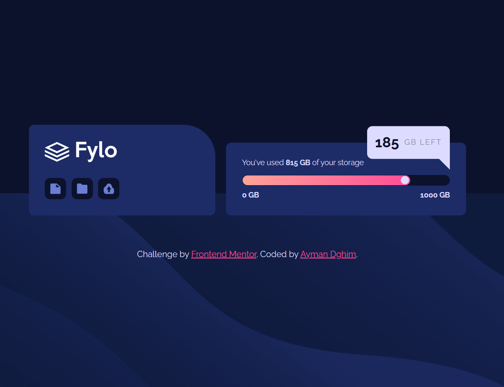
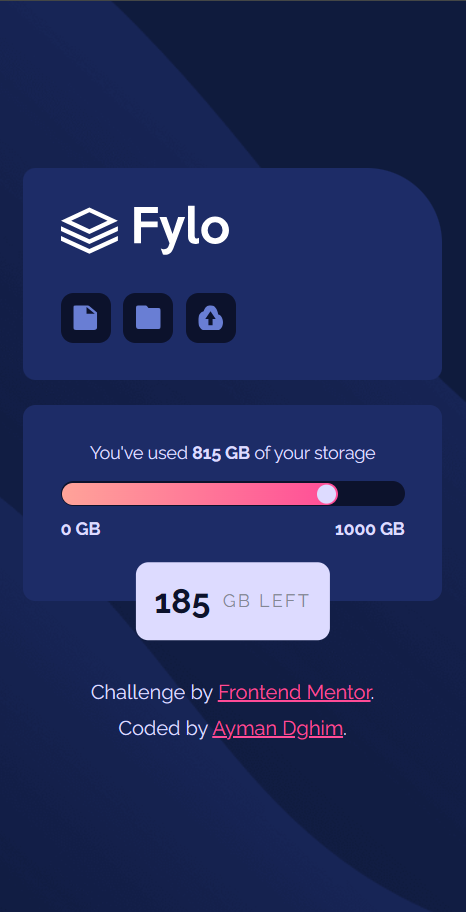

# Data-Storage-Component-Master
A responsive data storage component built with HTML and CSS, displaying storage usage through a visual progress bar and remaining storage indicator. Designed to adapt seamlessly to different screen sizes.

## Folder Structure

```text 
Data-Storage-Component-Master/
  |--- design/
  |  -|--- screenshot-desktop.png
  |  -|--- screenshot-mobile.png
  |--- images/
  |  -|--- bg-desktop.png
  |  -|--- bg-mobile.png
  |  -|--- favicon-32x32.png
  |  -|--- icon-document.svg
  |  -|--- icon-folder.svg
  |  -|--- icon-upload.svg
  |  -|--- logo.svg
  |--- index.html
  |--- style.css
  |--- README.md
```

## Screenshots

### Desktop Design



### Mobile Design



## Links

- **Live Site:** [View Live Site](https://ayman-daghim.github.io/Data-Storage-Component-Master/)

## Technologies Used

- HTML5
- CSS3
- Flexbox
- Responsive Design


## Communication

- **Instagram:** [ayman.daghim](https://www.instagram.com/ayman.daghim)
- **WhatsApp:** [Contact Me](https://wa.me/963981871596)
- **Facebook:** [Ayman Dghim](https://www.facebook.com/profile.php?id=61596589265672)
  

## Author

**GitHub:** [ayman-dghim](https://github.com/Ayman-daghim)<br>
**Frontend Mentor:** [ayman-dghim](https://www.frontendmentor.io/profile/Ayman-daghim)

